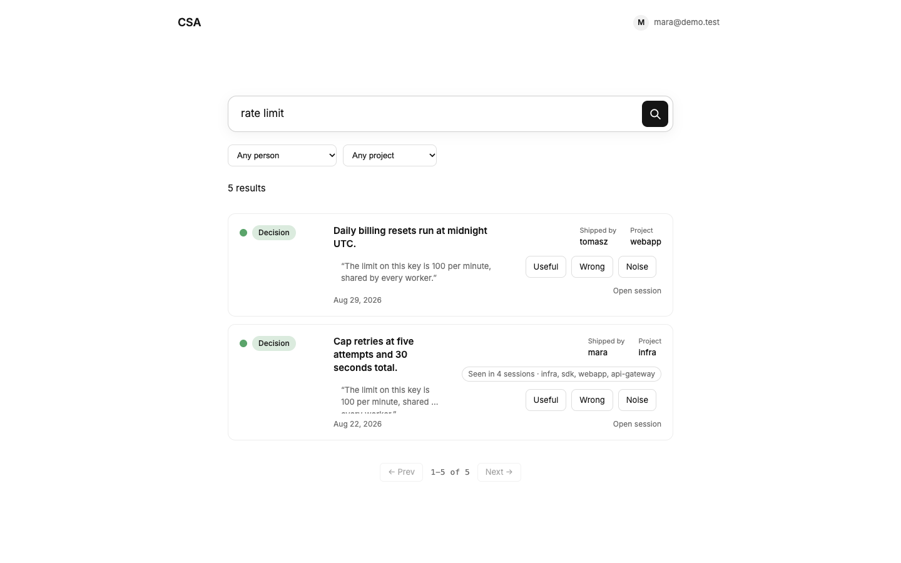
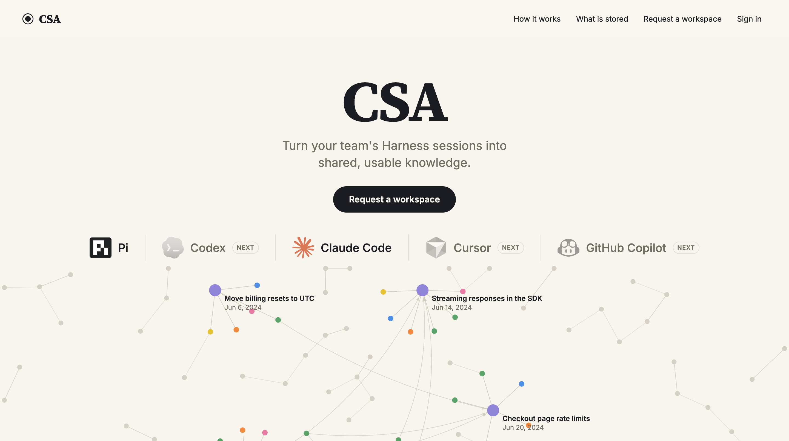
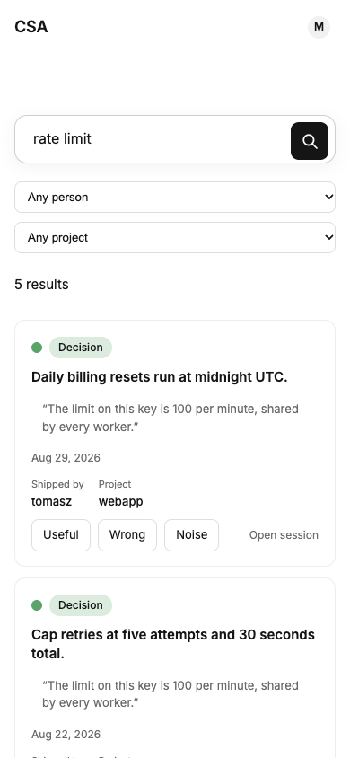
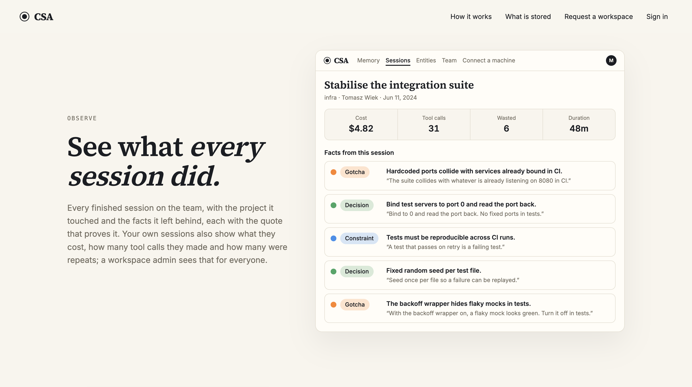
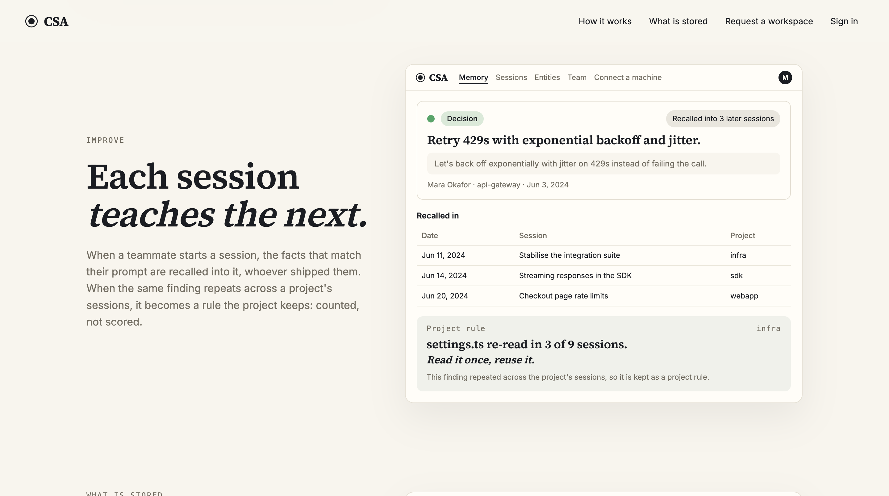

# CSA · Coding Session Analyzer

Turn your team's AI coding sessions into shared, usable knowledge.

## Why CSA?

“Why did you choose Postgres instead of SQLite?” “Ask my session.”

What is the most important skill we should create from our repeated work? Use CSA and find out.

Why give teammates access to every session? Choose exactly which projects and sessions become shared knowledge.



More synthetic UI examples:






## Requirements

- Docker Engine 24 or later with Docker Compose v2.20 or later
- Claude Code, Python 3.9 or later, and macOS or Linux for the plugin
- An Anthropic or OpenAI API key when you are ready to extract sessions

The installer supports Anthropic and OpenAI directly. Settings also supports Anthropic, OpenAI, Azure OpenAI, and
OpenAI-compatible endpoints. Bedrock and Vertex require the image target documented in
[the model guide](docs/quickstart.md#which-models-need-claude-code).

## Start the server

Run the guided, idempotent installer:

```sh
curl -fsSL https://raw.githubusercontent.com/nabooai/coding-session-analyzer/master/install.sh | sh
```

It checks Docker, asks for the workspace, administrator, URL and model path, writes private configuration,
starts CSA, waits for health, and prints the sign-in URL. To inspect the script first—or see exact expected
output, consent stops, and recovery steps—follow [INSTALL.md](INSTALL.md).

## Connect Claude Code

Run the exact connection command printed by the server installer. It installs the readable plugin disabled;
inspect it, enable it, then follow `/csa:connect`. Read the browser consent page, verify the two-word code,
and click **Authorize**. Only sessions started after consent ship automatically. Past sessions are not
uploaded unless you explicitly send one.

## Install using Claude Code

```text
Install CSA by following
https://github.com/nabooai/coding-session-analyzer/blob/master/INSTALL.md.

Use the “server + Claude Code plugin” path. Explain each command before running it.
Ask before using my model credentials, uploading existing sessions, changing project-sharing scope,
or enabling automatic sharing.
```

`nabooai` is the single pending owner placeholder. Replace it after the repository transfer.

## How it works

```text
Claude Code session hooks
  → local consent, project scope, and secret redaction
  → authenticated ingestion and durable queue
  → JSONL/session normalization
  → small-model extraction of typed facts, entities, relationships, and evidence
  → SQLite corpus, entity/temporal graph tables, and FTS5 index
  → lexical/BM25 retrieval, filters, deterministic reranking, and graph context
  → web search and MCP recall
  → background extraction, judging, deduplication/compaction, and retention workers
```

Lexical search matches exact technical terms, identifiers, paths, and errors with BM25, then ranks
results using provenance, recency, and fact-type signals. The configured main model handles richer
questions; the configured small model handles extraction and routing work.

## What leaves your machine

In automatic mode, locally redacted prompts go to your CSA server for recall, and locally redacted
finished sessions go there for extraction. The server sends redacted content to the model provider you
configure. In manual mode, nothing leaves until you run `/csa:send-session`. Project scope can exclude
folders. The plugin sends no telemetry. See [Security](SECURITY.md) and [redaction](docs/redaction.md).

## Verify your first search

Finish a new Claude Code session containing a concrete decision. Wait for the worker, open
`http://localhost:8766`, and search for an exact identifier from that decision. You can also
ask for it in a new connected Claude Code session through MCP recall.

## Development

See the [public documentation](docs-site/index.md), [CONTRIBUTING.md](CONTRIBUTING.md), and
[architecture](docs-site/architecture.md).

Licensed under [Apache-2.0](LICENSE). Security reports follow [SECURITY.md](SECURITY.md).
